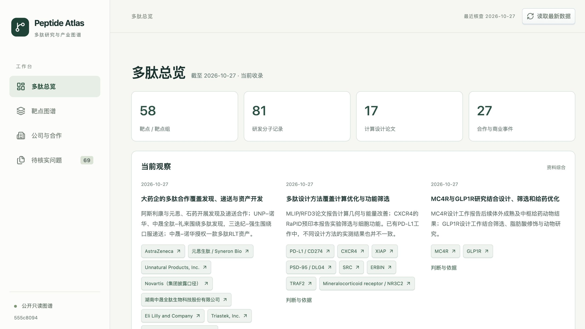

# Peptide Atlas

**按靶点看多肽，沿分子追研发，沿公司看合作。**

开放协作的多肽研究与产业图谱：从论文、专利、临床登记、监管和公司披露中整理可追溯信息，用时间轴与关系图呈现。覆盖多肽、肽偶联物与肽蛋白融合物，计算设计和实验研发分别展示。

**[直接浏览公开图谱](https://ivandon15.github.io/peptide-atlas/)** · [公开数据快照](data/public/snapshot.json) · [如何维护和发布](docs/publication.md)



[查看总览高清原图](docs/images/overview-hd.jpg) · [查看分子谱系与进度高清原图](docs/images/lineage-hd.jpg)（2545px 宽，2倍重新渲染）

## 可以看什么

- **多肽总览**：当前收录分布、有依据的方向观察、近五天公开进展。
- **靶点图谱**：主时间轴追踪具名研发项目；SAR类似物、探针和专利研究分子在详情展开，计算研究按论文归档。保留实验、临床、监管、CMC及有依据的演变关系。
- **公司与合作**：资产许可、发现平台、递送制造、投资与收购；区分阶段、权利、责任、首付和潜在里程碑。
- **待核实问题**：为什么不确定、需要什么资料、原文在哪；补材料后核验更新，无法取得的来源可归档并保留历史。

这是持续补全的公开信息图谱，收录数量不代表全球总量。每条来源保留读取范围，候选、计划和不确定关联不会自动变成已确认结果。

## 本地运行

需要 **Node.js 22.13+、npm、Python 3.10+**。SQLite 内置于 Python；额外 Python 运行依赖只有 `pypdf`。

```sh
git clone https://github.com/ivandon15/PeptideAtlas.git
cd PeptideAtlas
python3 -m venv .venv
.venv/bin/python -m pip install -r requirements.txt
npm ci
npm run build
ATLAS_PYTHON=.venv/bin/python npm start
```

打开 [http://127.0.0.1:8766/](http://127.0.0.1:8766/)。Windows PowerShell 的环境变量及虚拟环境写法见[运行说明](docs/operations.md)。

首次启动从 [data/pilot.json](data/pilot.json) 建立本地数据库；以后启动保留现有数据。已有记录可离线浏览，检索新来源需要联网。浏览工作台不需要 OpenAI、Jev 或云服务密钥；使用 Codex 调研所需账户由使用者自行提供。

## 用自己的 Codex 维护

在 Codex 中打开仓库，让它先读 [AGENTS.md](AGENTS.md)。例如：

> 按靶点调研、公司合作调研、情报综合三个流程更新 IL23R。先读现有身份和待核实问题，补查论文、专利、登记与公司原始披露，保留未知和检索范围，通过 CLI 入库后更新观察。

| 流程 | 负责什么 |
| --- | --- |
| [靶点调研](.agents/skills/peptide-target-research/SKILL.md) | 发现方法、分子、实验、谱系、CMC 与阶段 |
| [公司合作调研](.agents/skills/peptide-company-research/SKILL.md) | 多肽公司、资产及平台合作、权利、支付与履行 |
| [情报综合](.agents/skills/peptide-intelligence-synthesis/SKILL.md) | 根据已核实事实形成带依据、限制和验证问题的观察 |
| [补充材料核验](.agents/skills/peptide-evidence-update/SKILL.md) | 核验用户提供的链接、文字或文件，修订事实和原问题 |

四个流程共用一份数据库。网页“重新读取”只加载数据库；不会启动联网调研、定时任务或 Codex。Jev 尚未接入。操作约束见 [AGENTS.md](AGENTS.md)及[共享数据协议](.agents/references/research-contract.md)。

## 一起维护

欢迎共同补全**信息、待核实问题、研究流程及 UI/UX**：

1. 遇到遗漏、错误或难用的交互，在 [Issues](https://github.com/ivandon15/PeptideAtlas/issues) 提供来源或复现步骤。
2. 直接修正时提交 PR：数据修改附原始链接、定位和不确定性；界面修改附前后截图。
3. 维护者审阅后合并，CI 检查数据关联、隐私边界、测试和构建。

共享**源码、公开资料的短摘要/链接和待研究问题**，也可逐项选择经审阅的资料综合观察供在线浏览。每个人的 SQLite、下载原文、上传文件与审阅历史留在本地。没有共享在线写库或自动多用户同步。`git pull` 不会覆盖你的研究或归档；已有库由自己的 agent 比对、核实后更新。详见[贡献指南](CONTRIBUTING.md)。

## 开发与验证

```sh
ATLAS_PYTHON=.venv/bin/python npm run dev  # 前端 5180，API 8766
ATLAS_PYTHON=.venv/bin/python npm test     # 后端、前端逻辑及公开数据检查
npm run build                           # 类型检查与生产资源构建
python3 package_source.py                # 生成不含私有数据的源码包
```

代码地图见[架构说明](docs/architecture.md)，备份和恢复见[运行说明](docs/operations.md)。**本地版负责调研与核验，在线版只读公开快照**；本地 API 不映射到公网。公开数据和界面通过 GitHub 维护，没有在线上传或多人写库。

## 许可

[MIT](LICENSE) 适用于软件和原创文档；论文、专利、商标及第三方材料权利归各自权利人。提交公开数据应使用自己的简短转述及原始链接，不上传受限全文。安全问题请见 [SECURITY.md](SECURITY.md)。
